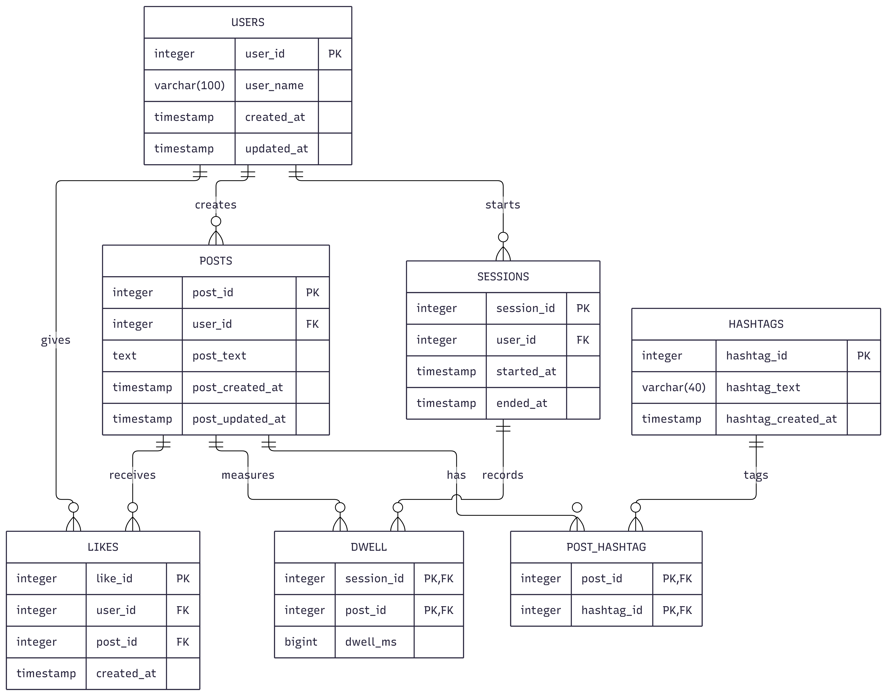

# EX603-socialmedia-database
Social Media Database Project

The following project is for BU Course EX603, building a relational model for a social media backend in Postgres.

# Domain - Social Media 
The following domain is social media to track the following five roles: users, posts, likes, hashtags and post_hashtags.The purpose of the backemnd application to store users tha create accounts by their user_id. Users can make posts and like other users posts. These posts can be associated with hashtags, and metrics can be stored about each post that each user spends dwelling on them. The structure has kept all distinct relations to add further relations such comments if they are requried if the requirements would evolve. 

The current schema represents the current strucutre which may evolve. 

The general schema for the social media relational model is described below: 

# Schema 

It was updated on 9/27/2026 to reflect sessions table addition when modeling dwell time for multiple different sessions a user might come back to a post. 
# Query Catalogue 
We have built query catolog for assignment 4 to model the aggregation of sample social media database with our findings on 10/25/2026.

The specific queries answered how failures such as post removals affect aggregations. Therefore, its important to have system in place to monitor aggregations overall as well by specific cohorts. 

# Technical Highlights 
The technical highlights is that over time the system is evaluating how posts are being removed and tracked with dwell time metrics. These include that the system is overall improving but not in Q4 in relation to removal reason. In addition, we can use window partitions in order to evalaute comparison of rows together and build more complex workflows. 

# What I would do differently 
I would build more comphrensive joins to handle the data analysis, as well as build more comprehensive framework to understand why dwell time and removal rate is happening and link it together.   
# Video Presentation

https://youtu.be/fSEqoeu4cbk - Video Presentation 

# How To Run IT 

The person can use the schema to load the database and then they can run the queries in ach of the queries path to learn about the system and how it is behaving. 